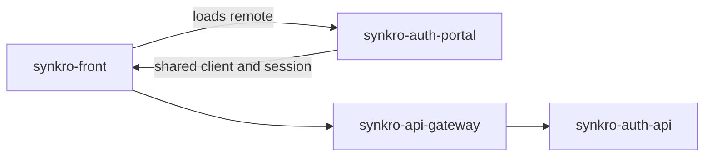

# synkro-auth-portal

> Auth web remote for login and ADMIN user/service-token management, mounted by synkro-front.

Part of the **SynkroTech SAS Sales Management System**. Architecture, decisions and
contracts live in [synkro-docs](https://github.com/code-corhuila/synkro-docs).

**Quick start:** from this root with Node 22, run `npm ci` and `npm run build`; mount the compiled remote through synkro-front. See [Getting started](#getting-started).

## What it does

- Exposes the login form while the Host owns authentication transport and session state.
- Provides ADMIN user search, registration, lookup and active non-ADMIN password reset.
- Provides service-token management through the Host's shared client.
- Keeps password-reset intent in session-bound memory and supports safe manual replay.

## Where it fits



The standalone page is not a second authenticated application. The Host supplies session, transport, global navigation and the browser-facing backend origin.

## Tech stack

| Component | Choice |
|---|---|
| Language / UI | TypeScript; React 19 |
| Build | Vite; @originjs/vite-plugin-federation |
| Tests | Vitest; compiled boundary checks; isolated Pact tooling |
| Runtime | NGINX remote, exposed internally on platform |

## Dependencies

| Depends on | Purpose | Configuration |
|---|---|---|
| synkro-front | Shared client, identity and remote entry | VITE_SHELL_ENTRY_URL |
| synkro-auth-api | Published domain operations | Host client through gateway |

## Getting started

Use **PowerShell or Bash** from this repository root with Node 22. Prepare local build inputs from `.env.example`.

```text
npm ci
npm run build
npm run preview
```

Build the remote before loading it in the Host. Preview is for local assets; the authenticated UI is mounted through the Host. For a container deployment, the Host serves the owning `/remotes/auth/` prefix.

For the complete platform, start from [synkro-infra-postgres](https://github.com/code-corhuila/synkro-infra-postgres).

## Configuration

The committed [.env.example](.env.example) is the configuration inventory.
Its values are examples; required inputs and defaults follow its comments and the
owning implementation. Keep real secrets in protected local files.

| Variable | Purpose |
|---|---|
| `VITE_BASE_PATH` | Connection address, origin or build-time entry point |
| `VITE_SHELL_ENTRY_URL` | Connection address, origin or build-time entry point |

Federation entry and base-path inputs are evaluated at build time. The remote does not configure a separate API origin.

## Interface

| Entry / route | Use |
|---|---|
| ./Login and ./App | Exposed federation modules |
| /login | Public login; Host-managed session |
| /users | ADMIN directory, registration, lookup and password reset |
| /service-tokens | ADMIN service-token operations |

## Project structure

```text
src/             exposed Login/App components
src/             user and token management views
deploy/          remote image and build-time federation inputs
scripts/         compiled production checks
tests/pact/      isolated consumer contracts
docs/            design and password-reset operating details
```

## Testing

```text
npm run lint
npm test
npm run coverage
npm run build
npm run check:production-build
npm run test:contract
```

Password-reset DOM/compiled-boundary regressions and consumer contracts are separate checks. Detailed delivery notes retain their original reported test and browser-evidence limits.

## Branching and contributing

Use a `feat/`, `fix/` or `chore/` child branch and a PR into `develop`.
Permanent branches are `develop`, `qa` and `main`; none accepts direct commits.
Promote through a `qa-<description>` or release child with `git cherry-pick -x`.
`main` requires approval from `ariel5253`. Use English Conventional Commits.
See [Git conventions](https://github.com/code-corhuila/synkro-docs/blob/main/00-governance/git-conventions.md).

## Further documentation

- [Password reset operations](docs/password-reset-operations.md).
- [Login integration](docs/login-integration.md).
- [Testing](docs/testing.md).
- [Domain rules](https://github.com/code-corhuila/synkro-docs/blob/main/02-domain/entities-and-rules.md), [contracts](https://github.com/code-corhuila/synkro-docs/tree/main/07-api/contracts/openapi) and [testing strategy](https://github.com/code-corhuila/synkro-docs/blob/main/11-quality/testing-strategy.md).

<!-- Preserve previously published README section links. -->
<a id="branching"></a>
<a id="users-password-reset-by-an-admin-hu-auth-19"></a>
<a id="login-remote-hu-fe-08"></a>
<a id="auth-19-review-checks"></a>
